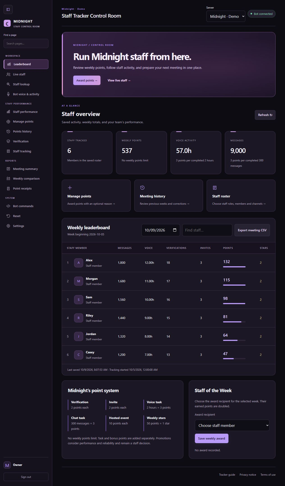
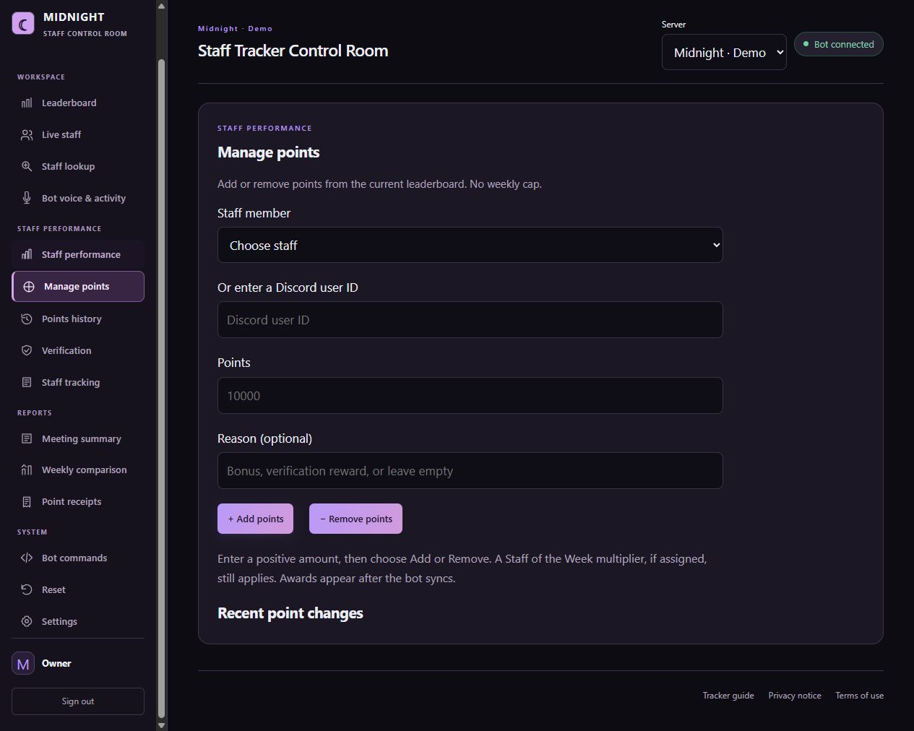
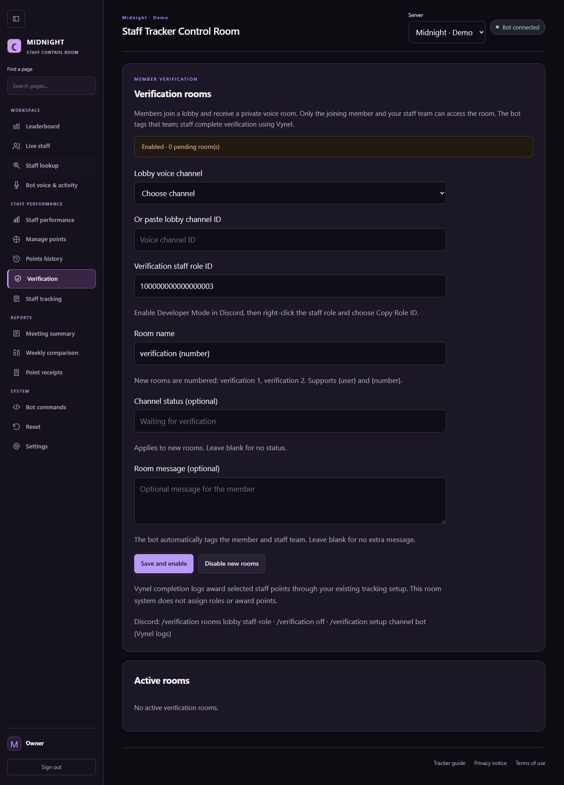

 

Night Bloom is a Discord staff bot with a private control room. It tracks your team, awards points, and runs verification rooms. First built for Midnight Community.

**Night Bloom is not public.** To add it to your server, message **`meatforlove`** on Discord.

## Control room 管理室

Track the team, award points, review saved activity and configure each server from one dashboard.

## Features 機能

- Ten-place Discord leaderboard with staff profiles and a personal rank button.
- Automatic message and voice tracking, including members who appear offline. Voice time adds up across sessions, with a configurable minimum of 2–5 human participants.
- Point awards and deductions with optional reasons, no default weekly cap, and point receipts.
- Staff lookup with roles, account age, voice channel and saved activity.
- Private verification rooms for the joining member and the staff team. Staff complete verification through Vynel; completion logs feed the points tracker.
- Weekly comparison, meeting summaries and CSV exports.
- Separate settings and data for each server.
- Slash commands and configurable text prefixes per server.
- Leaderboard updates every two minutes by default.
- Optional 30-day remembered sign-in with secure session cookies.

## Bot health 状態

Each server has a **Bot health** page:

- Connection status from the latest bot update.
- Last successful sync, in the server dashboard's timezone.
- Full count of pending website changes.
- Recent saved and failed changes, with their results.
- A manual refresh button and automatic status updates.

A delayed sync is shown separately from a confirmed connection. It does not mean the bot stopped tracking.

## Manage points ポイント

Add or remove points from the dashboard, or use `/points add` and `/points remove` in Discord.

## Verification rooms 認証部屋

Set a lobby channel and a staff role by ID. Members get a private room when they join the lobby. Empty rooms are cleaned up automatically.

## Add Night Bloom 依頼

Night Bloom is set up by hand for each server. Message **`meatforlove`** on Discord.

This repository holds documentation and screenshots only. The bot source, credentials and production records are private. Screenshots use demo data.

